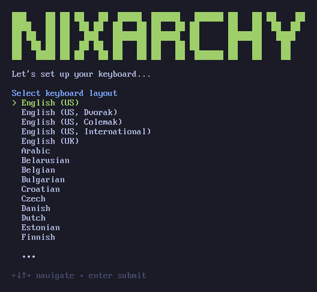
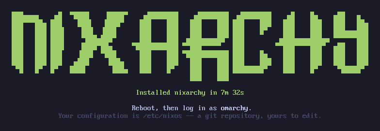

# The ISO in depth

[Getting Started](getting-started) walks the installer's seven questions.
This page is everything around them: writing the stick from Windows or macOS,
what the image carries, answering the questions ahead of time,
what the installer leaves in `/etc/nixos`, and the caveats people hit. It used
to be the README's install section.

## Writing the stick from Windows or macOS

**Use [balenaEtcher](https://etcher.balena.io/) with the network image.**
That combination has no wrong answer in it: Etcher only ever writes an image
byte-for-byte -- no filesystem to choose, no partition scheme, no mode prompt --
and the image is one file.

**If you use Rufus instead**, choose **DD Image mode** to write the image
byte-for-byte.

**Turn Secure Boot off** in your firmware before booting the stick. This
project does not sign its bootloader, which is
[a decision rather than an oversight](https://github.com/olafkfreund/nixarchy/blob/main/docs/internals/design.md#what-is-left).

**Keeping Windows on the same disk?** Free the space from inside Windows
first, and read [the dual boot page](dual-boot-install) --
it covers Shrink Volume, the 32 GiB floor the installer enforces, and why
BitLocker has to come off before you start.

Or build it yourself, which is the same image from the same commit:

```
nix build --extra-experimental-features 'nix-command flakes' \
  github:olafkfreund/nixarchy#iso-net
sudo dd if=result/iso/nixarchy-*.iso of=/dev/sdX bs=4M status=progress oflag=sync
```

The `--extra-experimental-features` flag is there because flakes are off by
default on a stock Nix, and a machine that has never run one is exactly the
machine someone builds an installer on. On NixOS with this module it is
redundant and harmless. **Building on a non-NixOS host** also needs the Nix
daemon running — `systemctl enable --now nix-daemon.socket`, and your user in
the `nix-users` group on Arch. If `/nix/store` is missing, the Nix install did
not finish; do not create it by hand, because a multi-user store wants
`root:nixbld` and mode `1775` rather than whatever `mkdir` leaves behind.


`#iso-net` is about 2 GB. It needs a network to download the desktop during
the install; its first screen offers Wi-Fi if there is no cable.

No boot menu, no login prompt: the installer is what comes up.



Keyboard, then your account, then the disk — [step by step in the
manual](https://olafkfreund.github.io/nixarchy/manual/getting-started). Encryption is on unless you press
Ctrl+C at the overwrite warning, and one password serves your user, root and the
disk alike.

Then it gets out of the way. The log goes to `/var/log/nixarchy-install.log`
rather than the screen, because a wall of store paths tells nobody anything they
can act on.


*The whole install, four minutes at four-second intervals.*

Measured, not estimated: `checks.install` reports the installer's own figure
every run from its seeded VM. The number on the finish screen is the same one.



Reboot and you are at the desktop. An encrypted install goes straight there —
the passphrase you typed at boot already proved who you are, so there is no
second password.

**`#iso-net` needs a network.** It fetches the system from binary caches,
which is why it stops at a Wi-Fi prompt on a machine with no cable.
The 75 selectable apps come from the Install menu after first boot, from your
own nixpkgs.

**You can answer the questions ahead of time.** `nixarchy-install --answers
<file>` takes every answer from a file and asks nothing, which is how the VM
tests drive it and how you reinstall a machine the same way twice:

```
device=/dev/nvme0n1
encrypt=yes
luks_passphrase=...
hostname=kestrel
username=you
password=...
timezone=Europe/Copenhagen
keymap=us
```

`tests/install.nix` is the working reference for it.

**What you get is a flake you own.** `/etc/nixos` is a git repository holding a
`flake.nix`, the `disk-config.nix` that formatted the disk, the `flake.lock`
the image was built with — not a fresh one, because regenerating it would make
your first boot differ from what was actually installed — and your machine as
a directory under `hosts/`:

```
/etc/nixos
├── flake.nix              finds machines by reading ./hosts
├── flake.lock
├── disk-config.nix
└── hosts/nixarchy/        default.nix, configuration.nix,
                           hardware-configuration.nix, nixarchy-apps.nix
```

A second machine is a second directory; `flake.nix` reads `./hosts` and there
is nothing in it to edit. `imports = [ ./nixarchy-apps.nix ];` is already
written for you: forgetting that line is the silent failure [the selection has to be imported](configuration#the-selection-has-to-be-imported)
warns about for machines you configure by hand, and the installer does not let
you make it. Edit it and run `nh os switch`. Nothing the installer did is
hidden from that directory, which is the point: a rebuild immediately after
install builds nothing, because everything it did is described there.

Installing a second machine from that same repository, and letting them keep
themselves current, is [many machines, one repo](many-machines).

**Caveats worth knowing before you write the stick.**

**In Rufus, answer the ISOHybrid question with DD.** Rufus asks once:

> This image is an ISOHybrid image … Write in ISO Image mode (Recommended)
> / Write in DD Image mode

**DD Image mode** writes the image without changing its bootloader or partition
layout. The stick then looks empty or unreadable to Windows,
which is correct. [balenaEtcher](https://etcher.balena.io/) never asks — it
only does raw writes — so it is the safer choice if you would rather not have
to catch a dialog. On Linux, `dd` as above.

Tools that boot the image with their own loader are a different question, and
the honest answer is "sometimes". **Ventoy** booted a previous image: a
tester's install log shows `NIXARCHY_4_0_2` mounted at `/iso` from Ventoy's
exfat partition, with the installer running and disko partitioning the disk.
That is evidence for that image, not a guarantee for a new one.

It is still not what to reach for first. Ventoy, unetbootin, YUMI, multiboot
sticks and "loopback this ISO" entries in an existing GRUB all interpose their
own loader between the firmware and ours, which is one more thing that can
differ between your machine and the one this was tested on -- and when it does
go wrong it goes wrong at boot, before there is anything to read a log from.
A raw write has no such layer. If Ventoy is already how you keep your sticks,
it is reasonable to try; if you are choosing now, choose the raw write.

Windows' own *Burn disc image* is for optical media and will not make a
bootable stick at all.

**It asks how to use the disk, and one of the answers erases it.** The first
screen offers a free-space install -- it keeps what is already on the drive and
takes only unallocated space, which is how you put this beside Windows -- and a
full-disk install, which does exactly what it says. There is still no partition
*editor*: both modes need at least 32 GiB, the smallest disk nixarchy supports.
A full-disk install needs a 32 GiB disk; free-space mode needs 32 GiB of
contiguous unallocated space that you made beforehand, with Windows' own Disk Management or `gparted`, and
it refuses rather than shrinking anything itself.

Full-disk mode is one file, `installer/disk-config.nix`, run against the disk
you name. Anything already there is gone.

Making that space is a Windows job and is done before you boot the stick:
[the dual boot page](dual-boot-install) covers Shrink Volume,
the 32 GiB floor, Fast Startup, and BitLocker.

It is **UEFI only** — the layout is an ESP with systemd-boot, and there is no
BIOS path.

**`x86_64-linux` only.** Nothing else is built or tested.

And if you encrypt, **the passphrase prompt at boot comes before Bluetooth
exists**. A wireless keyboard that pairs after the desktop is up cannot type
into the initrd, so the machine sits there waiting for a key you have no way to
press. Upstream's manual carries the same warning because people hit it. Use a
wired keyboard for the first boot, or do not encrypt.
