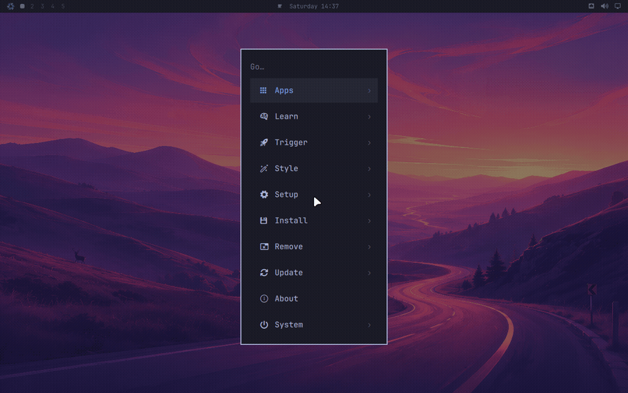

# Updates

_Update > Nixarchy_ in the Omarchy menu (`Super + Space`) — upstream labels it
_Update > Omarchy_ — is still the one place to keep everything current. The
row runs `omarchy update`, and this page is about what that means on NixOS and
what happened to the rest of upstream's update machinery. The mechanics —
`nix flake update`, the four rebuild modes, generations, rollback and the
stale-session trap — are on [Updating NixOS](updating-nixos.md), and are not
repeated here.



## What an update is

On Arch an update installs a new `omarchy` package, runs its migrations, and
upgrades every system package from the Omarchy mirror. Those are three
different mechanisms.

Here they are one. Omarchy, nixpkgs and nixarchy are all inputs to your flake,
and `flake.lock` pins each of them to an exact revision. `omarchy update`
moves every pin forward and rebuilds:

```sh
nh os switch --update <flake>
```

That is one command for both halves. `nh` is a front end to the same
nixos-rebuild machinery, so the result is identical -- what it adds is a live
view of what is building and a diff of the packages that actually changed,
which on an update is the only question worth asking.

It asks first. A new Omarchy release arrives as a source bump of the `omarchy`
input, so the menus, themes and commands come along with it. Your app
selection is not touched: it lives in a file you own.

Nothing is snapshotted before the update because the previous system is still
on disk as a generation; see [rolling back](#rolling-back-bad-updates).

The update-available icon next to the clock shows newer Nixarchy releases when
your flake follows the `release` branch. It stays hidden offline or with a
fixed or custom Nixarchy pin, and does not report nixpkgs updates.

## Channels: two separate choices

Upstream has four channels: stable, RC, edge and dev. Each one swaps both the Omarchy
source and the packages around it. Here those are two independent choices,
each with its own group in the menu:

| menu | chooses | values |
|---|---|---|
| _Update ▸ Channel_ | which **Omarchy** you run | stable (the default), edge, dev (your own checkout) |
| _Update ▸ Nixpkgs_ | which **nixpkgs** you build on | `nixos-26.05` or `nixos-unstable` |

Any pairing works: stable Omarchy on unstable nixpkgs, which is what most machines run, or
edge Omarchy on 26.05. Switching one never touches the other. RC is not
offered.

Both groups edit your `flake.nix` under the rule `nixarchy-unfreeze` set: only
lines this project wrote get rewritten, and a flake you have reshaped is
refused rather than guessed at. **[Channels](channels)** has the commands, what
each channel is, and how to get back.

The update-available icon next to the clock tracks the `release` branch, so it
stays hidden on edge and dev.

## Firmware updates

_Update > Firmware_ runs `omarchy-update-firmware`, which is upstream's
script unchanged: it calls `fwupdmgr refresh --force` and `sudo fwupdmgr
update`. Its first step is to install `fwupd` if `fwupdmgr` is missing, which
goes through `omarchy-pkg-add` and therefore stops. Enable the service in
your configuration once and the row works from then on:

```nix
services.fwupd.enable = true;
```

Plenty of firmware can only be written during a reboot, so expect to be asked
for one. The step that copies an EFI binary into `/boot/EFI/arch/` looks for
an Arch path that does not exist here and is skipped.

## Direct updates, and why there is no guard

Upstream stops a bare `pacman -Syu` because it would skip the snapshot and the
migrations. Here there is nothing to guard: `nix flake update` followed by
`nixos-rebuild switch` **is** the update, and running those two commands
yourself is exactly what `omarchy update` does. The only thing you lose by
running them by hand is the confirmation prompt.

The more useful distinction is between updating everything and updating one
input. `omarchy update` moves all of them;
`nix flake update nixpkgs --flake <flake>` moves one. When you are chasing a
specific fix, the second is the
better habit — see [Updating NixOS](updating-nixos.md#the-long-way-and-when-you-want-it).

## When nixarchy takes over a module your flake also imports

An input nixarchy pulls in can collide with the same input in your own flake,
and the error names neither of them:

```
error: The option `services.snap.enable' in `…/flake.nix, via option
flake.nixosModules.default' is already declared in `…/flake.nix, via option
flake.nixosModules.default'.
```

Both halves of that message name the **same store path**. It is one module
imported as two separate values, which the module system cannot deduplicate, so
there is no version skew to go hunting for -- comparing the two flakes' locks
finds them identical.

This is live today for **nix-snapd**. nixarchy imports
`nixarchy-flatsnap.nixosModules.default` (`modules/nixos.nix`), and that pulls
nix-snapd in, so a host that also carries
`inputs.nix-snapd.nixosModules.default` gets it twice. Importing it yourself was
the correct thing to do before nixarchy took it over, which means this lands
precisely on long-standing users, and it is triggered by the **pin bump alone**
-- nothing about your own configuration has to change.

**The fix is to drop your own import.** Snap still works: it comes from
nixarchy, inert until `~/.config/nixarchy/flatsnap.nix` declares something.

nixarchy cannot detect this for you. A module's `imports` are what *build* the
option set, so they cannot ask whether an option already exists -- guarding the
import on `options ? services.snap` is an infinite recursion, not a missing
feature (checked, #947).

## Machines that update themselves

A machine can pull its configuration from a git repository on a timer instead
of waiting to be told:

```nix
programs.nixarchy.fleet = {
  enable = true;
  url = "github:you/config";
};
```

Off unless you turn it on, and worth understanding before you do: the running
system then comes from the **remote** flake, so local edits under `/etc/nixos`
that were never pushed are reverted at the next pull. See
[many machines, one repo](many-machines).

## Rolling back bad updates

The snapshot upstream restores from the boot menu is a generation here, and
you have one for every rebuild you have ever done, not just the last update.

```sh
sudo nixos-rebuild --rollback switch
```

or pick the previous entry in the boot menu. To see what an update actually
changed, before deciding whether to roll it back:

```sh
nix profile diff-closures --profile /nix/var/nix/profiles/system
```

`nix-collect-garbage -d` deletes old generations. It is how you get disk
space back, and it is also the only command that removes your rollback path,
so run it after an update has proved itself, not before.

## `omarchy reinstall` is not a recovery route

Upstream's answer to corrupted configuration is `omarchy reinstall`, which
reinstalls the packages, downgrades to stable and resets every config file.
The command exists here but cannot complete: its first act is `pacman -Suu`,
the shim refuses, and `set -e` aborts before any configuration is touched.
That is the right outcome — half of a reinstall would be worse than none —
but it means the command does nothing.

What replaces it depends on what broke:

| Symptom | Do this |
|---|---|
| A rebuild left the desktop broken | Roll back the generation |
| One app's config is wrong | `omarchy refresh <app>` restores that app's defaults |
| `~/.config/hypr` or another Omarchy config is mangled | `omarchy refresh` for it, or `git checkout` if you keep `~/.config` in git |

Nothing under `$OMARCHY_PATH` can be corrupted by you, because it is a
read-only store path. If a file there is wrong, it was wrong in the release,
and the fix is a bump of the `omarchy` or `nixarchy` input.
