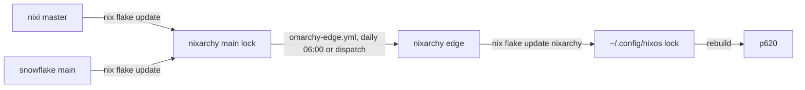

# Spec: Track nixi master and ship the snowflake companion

## Design

### How an update reaches p620



The user's config follows nixarchy's `edge` branch (`github:olafkfreund/nixarchy/edge`,
`~/.config/nixos/flake.nix:68`), not `main`. `edge` is rebuilt from `main` by
`.github/workflows/omarchy-edge.yml`, daily at 06:00 or on `workflow_dispatch`. So after this
merges to `main`, p620 picks it up once `edge` is rebuilt.

### nixarchy

**1. The nixi input follows master** (`flake.nix`, the `nixi` input, ~227).

- `url = "github:olafkfreund/nixi-nixarchy/d99e335…"` → `url = "github:olafkfreund/nixi-nixarchy";`.
  No ref means the default branch, which is `master`.
- Keep both `follows` (`nixpkgs`, `omarchy`).
- `flake.lock` goes to current master (`39af9e3` or later) through
  `nix flake update nixi`.
- Rewrite the comment block (~139–226):
  - Remove "Pinned to a COMMIT … never track a branch" and replace it with the user's decision
    (#1432): nixi tracks master; the lock is the pin; `nix flake update` moves it; and nixi's
    master has strict branch protection with required CI.
  - Keep the history of past pins (`1e25cb8`, `1c3fc7c`, …) only if it still explains
    something. Otherwise drop it, since the lock and git history carry it.

**2. A companion input** (`flake.nix`, next to `nixi`):

```nix
nixi-companion = {
  url = "github:olafkfreund/nixoarchy-snowflake";
  inputs.nixpkgs.follows = "nixpkgs";
};
```

- It has no ref, so it tracks `main`, the fork's default branch.
- `follows` keeps one nixpkgs in the closure. The fork's only input is `nixpkgs`.
- A comment says why it's an input (not in nixpkgs, and same maintainer) and that the fork
  has no CI (its risk; see Risks).

**3. Default the package** (`modules/home.nix`, the `services.nixi` block, ~875):

```nix
companion.package = lib.mkDefault
  inputs.nixi-companion.packages.${pkgs.stdenv.hostPlatform.system}.default;
```

- `enable` stays nixi's default (`false`). The package is only built and installed when a user
  sets `services.nixi.companion.enable = true` (nixi's `hm-module.nix:283`, `lib.mkIf`), so a
  machine that doesn't enable it gets no closure change.
- nixi already rebuilds the package with its bridge pinned in (`companionPkg`, `hm-module.nix:27`).
  nixarchy passes the plain package.

**4. Docs** (`docs/manual/ai.md`, the "Nixi, on SUPER + H" section ~260): a short paragraph covering:
- the snowflake companion, off by default;
- the one line to turn it on: `services.nixi.companion.enable = true;`;
- the example bindings;
- a link to nixi's README for what it leaves out.

### The user's config (`~/.config/nixos`), p620 only

**5. Enable** (`hosts/p620/nixos/nixarchy.nix`, the existing `services.nixi` block ~169):
`companion.enable = true;`.

**6. Keys:**
- A Nix-written `~/.config/hypr/nixi-companion-binds.lua`, the same pattern as `meet-binds.lua` and
  `ai-mirror-binds.lua`:
  ```lua
  -- Managed by hosts/p620/nixos/nixarchy.nix; edits are overwritten on rebuild.
  o.bind("SUPER + ALT + H", "Nixi companion: show or hide", "nixi-companion")
  o.bind("SUPER + ALT + J", "Nixi companion: listen", "nixi-companion listen")
  ```
- `bindings.lua` is user-owned, so one line is added there once, by hand:
  `pcall(require, "hypr.nixi-companion-binds")`. It is `pcall`, never a bare `require`, which
  would break the whole Hyprland config if the file went missing.
- `SUPER + ALT + H` and `+ J` appear in none of `~/.config/hypr/*.lua` or Omarchy's defaults.
  This is checked live (`hyprctl binds`) before the rebuild counts as done.

**7. Lock:** `nix flake update nixarchy` once `edge` contains the merge.

## Alternatives rejected

- **Keep a commit pin and bump by hand.** This is today's setup, and it's exactly why #98–#107
  never shipped. The user rejected it.
- **Track a tag.** nixi has one stale tag (`v0.10.0`), and releases land on master untagged.
- **Add the companion only in p620's config.** It then isn't part of nixarchy, which the user
  asked for (intent question 2).
- **Start the companion with the session (a user unit).** The fork's README and nixi's README
  both show it as on-demand, and the user picked keys.
- **Have nixarchy write the bindings for every user.** Bindings are a per-machine choice, and
  nixarchy doesn't write `bindings.lua` (user-owned). The README shows them as an example.
- **A CI check in nixarchy that builds the companion.** It would pull faster-whisper, piper and
  WebKitGTK into every CI run for an option that is off by default. Verification is a local
  build and eval instead (see Risks).

## Risks

- **Untested pushes arrive on update.**
  - The fork has no CI, so an update can bring a broken companion. That only affects
    machines with `companion.enable = true` (today, only p620), and it surfaces at rebuild,
    not at runtime.
  - nixi's master is protected by 5 required checks, so the risk there is lower.
- **Every nixarchy user's next update brings nixi #98–#107.**
  - These are the changes users see: stricter Guide secret reads, the stall guard (ends a
    session with no activity after 5 min, or a tool after 15), and voice session control.
  - Each was reviewed and is green on nixi's CI. The VM eval (`flake.nix` ~2653) and
    `checks.nixi` / `checks.menu-model-merge` catch build breakage.
- **`edge` may lag** by up to a day. The plan dispatches `omarchy-edge.yml` once after the merge
  rather than waiting for 06:00.
- **A conflict in `edge`.** If Omarchy-quattro commits conflict with this change, the edge job
  stops (it has a `from_candidate` path for hand resolution). This change touches `flake.nix`,
  `flake.lock`, `modules/home.nix` and docs, which quattro commits rarely touch.
- **The p620 key combination is taken at runtime by something not in the files** (a plugin). The
  live `hyprctl binds` check catches it.
- **A bare `require`** in `bindings.lua` would break all of Hyprland if the file went missing. Use
  `pcall`.

## Verification

| Check | Expected |
|---|---|
| `nix flake metadata` in nixarchy | `nixi` locked at ≥ `39af9e3`, `nixi-companion` at fork `main` HEAD; URLs carry no rev |
| `nix flake check` (nixarchy) and nixarchy CI on the PR | green |
| An eval of the VM config with `services.nixi.companion.enable = true` | evaluates; `home.packages` contains `nixi-companion` |
| The same eval with it off | no `nixi-companion` in the closure (`nix path-info -r` of home-files) |
| `nix build` of p620's toplevel after `nix flake update nixarchy` | builds |
| After the user's rebuild on p620 | `nixi-companion` on PATH; `SUPER + ALT + H` shows the snowflake; `hyprctl binds` lists both keys; `pgrep -af claude` shows `claude-agent-acp` under nixi's bridge, never `claude -p` |
| A later `nix flake update nixi` in nixarchy | moves the lock with no `flake.nix` edit |

The p620 rebuild itself is the user's to run.
